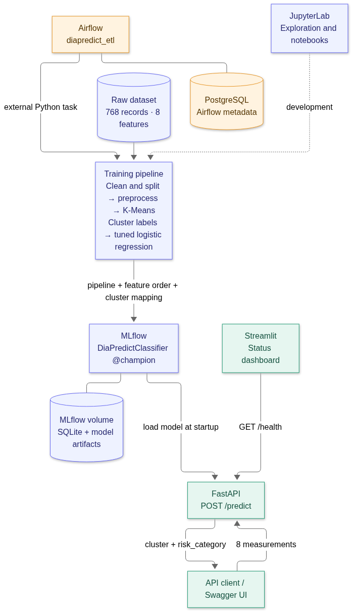
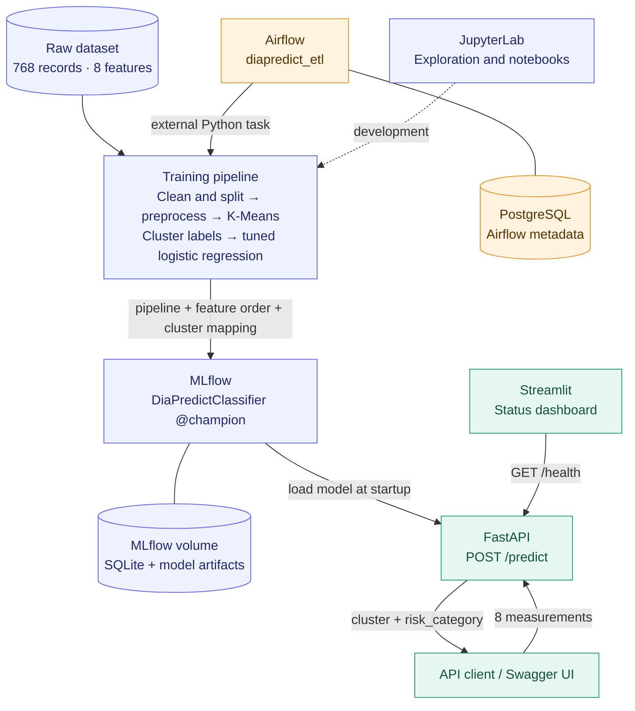
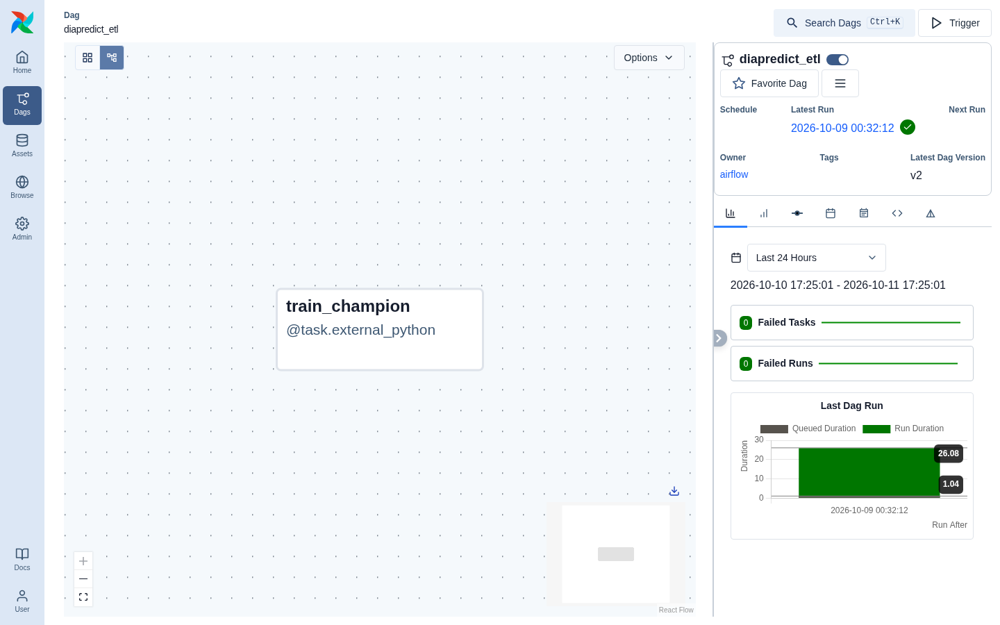
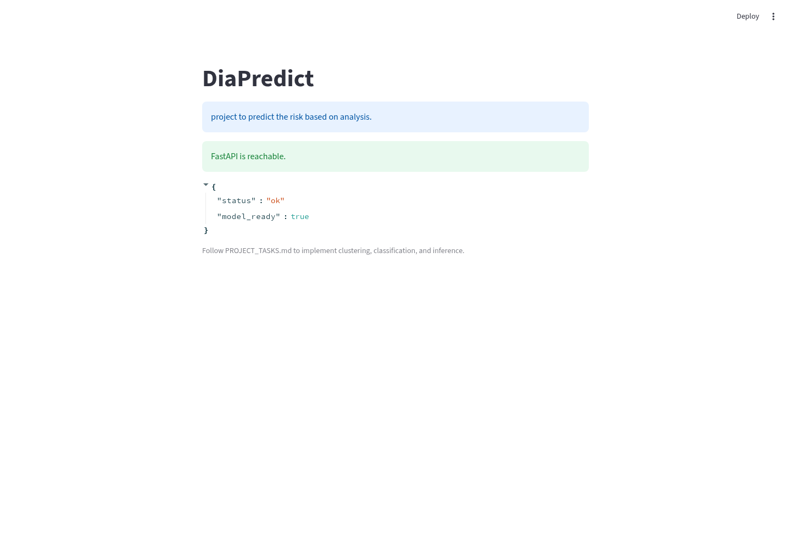
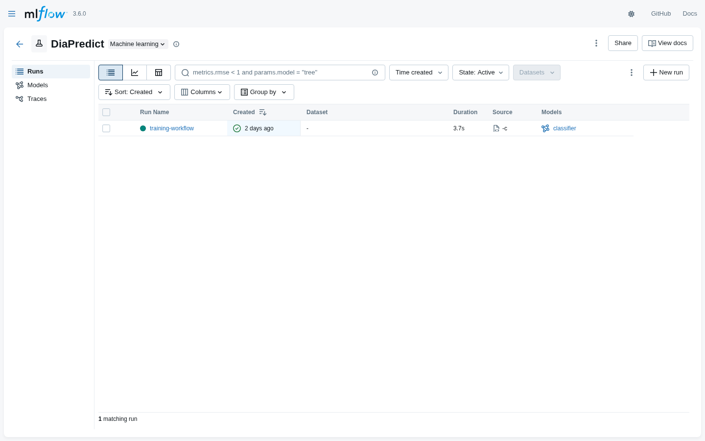
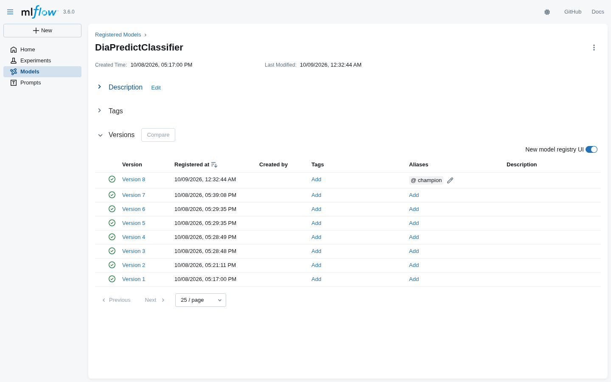
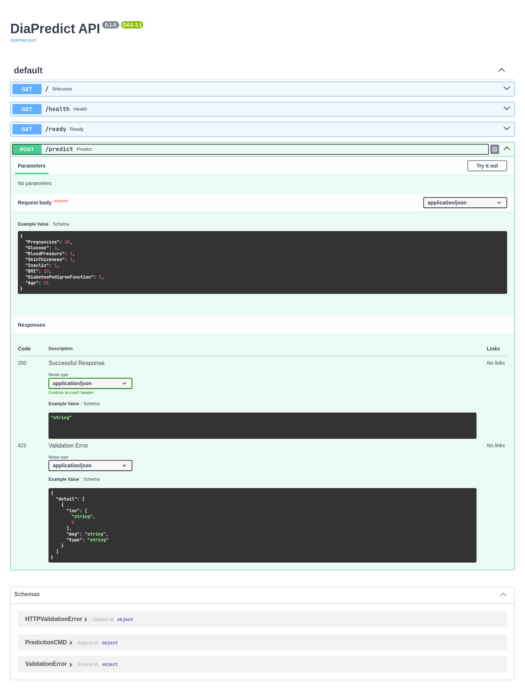

# DiaPredict

**From patient measurements to cluster-based predictions — a local machine learning workflow with Airflow, MLflow, FastAPI, and Streamlit.**

DiaPredict explores an end-to-end ML workflow on diabetes-related measurements. It groups records with K-Means, trains a classifier to reproduce those groups, registers the classifier in MLflow, and serves predictions through an API. Docker Compose brings the development and serving tools together.

> This is a learning project. The supplied dataset has **no diagnosis label**. Predictions describe learned clusters and project-defined `high` / `low` categories; they are not validated diabetes diagnoses or individual clinical risk estimates.

[Architecture](#architecture) · [Service screenshots](#service-screenshots) · [Quick start](#quick-start) · [Prediction API](#prediction-api) · [Project structure](#project-structure) · [Current limitations](#current-limitations)

## What the project demonstrates

- **Data preparation:** invalid-value handling, KNN imputation, log transforms, IQR outlier capping, and standard scaling.
- **Unsupervised learning:** three K-Means clusters fitted on training records.
- **Classification:** logistic regression tuned with five-fold stratified cross-validation, comparing configurations with and without SMOTE and selecting by macro F1.
- **Model management:** a complete preprocessing/classification pipeline registered as `DiaPredictClassifier`, with a `champion` alias and feature/cluster metadata.
- **Orchestration and serving:** an on-demand Airflow training DAG, FastAPI inference, and a Streamlit service-status page.

## Architecture



<details>
<summary>View the editable Mermaid diagram</summary>



</details>

Training and serving use the same feature order stored with the registered model. FastAPI loads the `champion` pipeline at startup and uses its cluster mapping to label the predicted group. Streamlit currently checks API health; it does not yet submit predictions.

Airflow uses `LocalExecutor`, with its scheduler, API server, and DAG processor inside one standalone container. Training runs in a separate Python environment within that container. PostgreSQL stores Airflow metadata; MLflow uses its own SQLite database and artifact volume.

## Service screenshots

These captures show the actual local application state. Run counts, model versions, and timestamps will change as the project evolves.

### Airflow — training orchestration

The manually triggered `diapredict_etl` DAG runs the `train_champion` task, which trains and registers the classifier.



### Streamlit — application status

The current interface reports whether FastAPI is reachable and displays its model-health response.



### MLflow — experiment tracking and model registry

The training workflow logs a classifier pipeline in the `DiaPredict` experiment and assigns the registered version the `champion` alias.





### FastAPI — interactive API documentation

Swagger UI exposes the API endpoints and the prediction request schema at `/docs`.



## Technology and services

| Component | Role | Local address |
| --- | --- | --- |
| Python 3.12 / scikit-learn 1.7.2 | Preprocessing, clustering, and classification | Container environments |
| Airflow 3.1.3 | On-demand training orchestration | [localhost:8080](http://localhost:8080) |
| MLflow 3.6.0 | Experiments, model registry, and artifacts | [localhost:5000](http://localhost:5000) |
| FastAPI 0.119.1 | Model inference and request validation | [localhost:8000/docs](http://localhost:8000/docs) |
| Streamlit 1.50.0 | API status interface | [localhost:8501](http://localhost:8501) |
| JupyterLab 4.4.10 | Notebook development and exploration | [localhost:8888](http://localhost:8888) |
| PostgreSQL 16 | Airflow metadata | Internal `airflow-db:5432` |
| Docker Compose | Six-service local environment | See [compose.yaml](compose.yaml) |

Published ports bind to `127.0.0.1`. Containers reach MLflow at `http://mlflow:5000` and FastAPI at `http://fastapi:8000`; browser URLs use `localhost`.

## Quick start

### 1. Configure the environment

Install Docker Engine with the Compose plugin. The commands below assume a POSIX shell and Python 3 on the host. Run them from the repository root.

Create `.env` only if it does not already exist:

```bash
python3 - <<'PY'
import os
import secrets
from pathlib import Path

path = Path('.env')
if path.exists():
    print('Keeping existing .env')
else:
    values = [
        f'LOCAL_UID={os.getuid()}',
        f'LOCAL_GID={os.getgid()}',
        f'AIRFLOW_UID={os.getuid()}',
        f'AIRFLOW_DB_PASSWORD={secrets.token_hex(24)}',
        'MLFLOW_MODEL_URI=models:/DiaPredictClassifier@champion',
    ]
    with path.open('x', opener=lambda p, flags: os.open(p, flags, 0o600)) as file:
        file.write('\n'.join(values) + '\n')
    print('Created .env')
PY

docker compose config --quiet
docker compose build
```

See [.env.example](.env.example) for the variable names. The old `scripts/init_env.py` referenced there is not present; the initializer above replaces that step. Jupyter currently uses the fixed local token `diapredict-local` configured in Compose; `JUPYTER_TOKEN` is not consumed.

### 2. Start the training infrastructure

```bash
docker compose up -d --wait --wait-timeout 300 airflow-db mlflow airflow jupyter
```

Open [Airflow](http://localhost:8080), sign in as `admin`, and retrieve the generated password locally with:

```bash
docker compose exec airflow cat /opt/airflow/state/passwords.json
```

Open `diapredict_etl`, unpause it if needed, and trigger a run. Wait for `train_champion` to succeed. In [MLflow](http://localhost:5000), confirm that `DiaPredictClassifier` has a version with the `champion` alias.

For a terminal-only training run, the same entrypoint can be invoked directly instead of triggering the DAG:

```bash
docker compose exec -w /workspace airflow /opt/airflow/training/bin/python -c 'from src.train import run_training; print(run_training())'
```

Each successful training invocation registers a new model version and moves `champion` to it. The DAG has no automatic schedule.

### 3. Start inference and the interface

FastAPI requires a registered model at startup, so complete the first training run before this step on a fresh installation.

```bash
docker compose up -d --wait --wait-timeout 300 fastapi streamlit
docker compose ps
curl --fail http://localhost:8000/health
```

Expected health response:

```json
{"status":"ok","model_ready":true}
```

Open [Streamlit](http://localhost:8501) or [Swagger UI](http://localhost:8000/docs). For notebook work, open [JupyterLab](http://localhost:8888) and enter the local token `diapredict-local`.

After retraining, restart FastAPI to load the latest `champion`:

```bash
docker compose restart fastapi
```

## Prediction API

| Method | Endpoint | Current behavior |
| --- | --- | --- |
| `GET` | `/` | Project welcome message |
| `GET` | `/health` | Returns `status: ok` and `model_ready: true` once the application has loaded |
| `GET` | `/ready` | Placeholder; currently returns HTTP 503 even when predictions work |
| `POST` | `/predict` | Returns the predicted cluster and its mapped category |
| `GET` | `/docs` | Interactive Swagger documentation |

Submit all eight measurements. The following values are an illustrative input:

```bash
curl --fail-with-body http://localhost:8000/predict \
  -H 'Content-Type: application/json' \
  -d '{
    "Pregnancies": 2,
    "Glucose": 120,
    "BloodPressure": 70,
    "SkinThickness": 25,
    "Insulin": 85,
    "BMI": 28.5,
    "DiabetesPedigreeFunction": 0.4,
    "Age": 35
  }'
```

Response shape (the actual cluster and category depend on the loaded model):

```json
{"cluster":"1","risk_category":"low"}
```

| Field | Accepted values |
| --- | --- |
| `Pregnancies` | Integer, 0–20 |
| `Glucose` | Number, greater than 0 and at most 600, or `null` |
| `BloodPressure` | Number, greater than 0 and at most 200, or `null` |
| `SkinThickness` | Number, greater than 0 and at most 100, or `null` |
| `Insulin` | Number, greater than 0 and at most 1000, or `null` |
| `BMI` | Number, 10–80, or `null` |
| `DiabetesPedigreeFunction` | Number, 0–3 |
| `Age` | Integer, 21–100 |

All keys are required. Nullable measurements pass through the model's imputation pipeline. Missing fields, out-of-range values, and non-finite values fail request validation with HTTP 422. See [PredictionCMD](app/command/PredictionCommand.py) for the schema.

## Data and training workflow

The bundled [CSV](data/raw/dataset-diabete-raw.csv) contains 768 records, eight input features, and an exported index column. It does not include a diabetes outcome label.

1. Remove the exported index and replace invalid measurements with missing values.
2. Split records into 80% training and 20% held-out data with `random_state=42`.
3. Fit preprocessing and three-cluster K-Means on training data; assign cluster labels to both partitions.
4. Build training-cluster profiles. A cluster is mapped to `high` only when its mean glucose is greater than 126, mean BMI greater than 30, and mean diabetes pedigree function greater than 0.5; otherwise it is mapped to `low`. These are project heuristics.
5. Tune a logistic-regression pipeline against the training cluster labels using five-fold stratified cross-validation and macro F1. Search over regularization strengths and optional SMOTE.
6. Log the fitted classifier pipeline and feature/cluster metadata to MLflow, register a version, and assign `champion`.

The current automated entrypoint prepares held-out labels but does not calculate or log held-out evaluation metrics. Its MLflow run logs the classifier model, rather than a complete metrics comparison. Decision-tree and random-forest configurations also exist for experimentation; the Airflow workflow currently trains logistic regression.

## Project structure

```text
DiaPredict/
├── app/
│   ├── api.py                    # Registry-backed FastAPI inference
│   ├── streamlit_app.py          # API connectivity and health display
│   └── command/PredictionCommand.py
├── dags/ETL.py                   # diapredict_etl / train_champion
├── data/
│   ├── raw/                      # Bundled input CSV
│   └── processed/                # Saved train/test datasets
├── docker/                       # Service Dockerfiles and dependency pins
├── docs/screenshots/             # README interface captures
├── models/                       # Local Joblib artifacts from development
├── notebooks/step1.ipynb         # Exploration and modeling notebook
├── reports/                      # Figure and table output directories
├── src/                          # Data, preprocessing, clustering, tuning, training
├── compose.yaml                  # Local service stack and persistent volumes
└── requirements.txt              # Training environment dependencies
```

FastAPI serves the MLflow model URI, not the Joblib files in `models/`. The [project checklist](PROJECT_TASKS.md) records the broader implementation roadmap; this README describes the current code.

## Operations and troubleshooting

```bash
# Inspect service state and recent logs.
docker compose ps
docker compose logs --tail=100 airflow mlflow fastapi streamlit

# Open the development container.
docker compose exec jupyter bash

# Rebuild after changing dependencies.
docker compose up -d --build fastapi

# Stop the stack while retaining named volumes.
docker compose down
```

| Symptom | What to check |
| --- | --- |
| FastAPI fails during startup | Confirm MLflow is healthy and `DiaPredictClassifier@champion` exists; check `MLFLOW_MODEL_URI` in `.env`. |
| Predictions still use an earlier champion | Restart FastAPI after changing the alias; the model is loaded at startup. |
| `/ready` returns 503 while `/predict` works | This endpoint remains a placeholder; use `/health` and a prediction request to inspect the current application. |
| Streamlit reports API unavailable | Inspect FastAPI logs and the model registration state. |
| Airflow cannot connect after a password change | Existing PostgreSQL volumes keep the password used when initialized; changing `.env` alone does not update it. |
| Port already in use | Free the conflicting localhost port or adjust the corresponding host-side Compose mapping. |

Named volumes preserve PostgreSQL data, Airflow state/logs, and MLflow metadata/artifacts. **`docker compose down -v` deletes these volumes**; use ordinary `docker compose down` for routine shutdown. Keep generated credentials private.

Training dependencies in Airflow live at `/opt/airflow/training`, isolated from Airflow's own packages. MLflow's SQLAlchemy 2.0.44 pin is intentional for compatibility with the installed MLflow version.
